# Weather Station Flex Card

A complete weather-station dashboard in one Home Assistant Dashboard card. Your own station's live readings, forecasts, radar, wind, sky, air quality, pollen and the garden, in a flexible panel grid over an animated weather background. Use it as a normal card, or as a full-screen wall display.

Current build: **v2026.11.01.110** · full history in [CHANGELOG.md](CHANGELOG.md)

---

## Screenshots

The same card, set up in different ways. All of it is done in the visual editor.

<!-- SCREENSHOTS:START -->
<table>
  <tr>
    <td align="center" valign="top" width="50%">
      <a href="screenshots/01-full-screen-wall-tablet.png">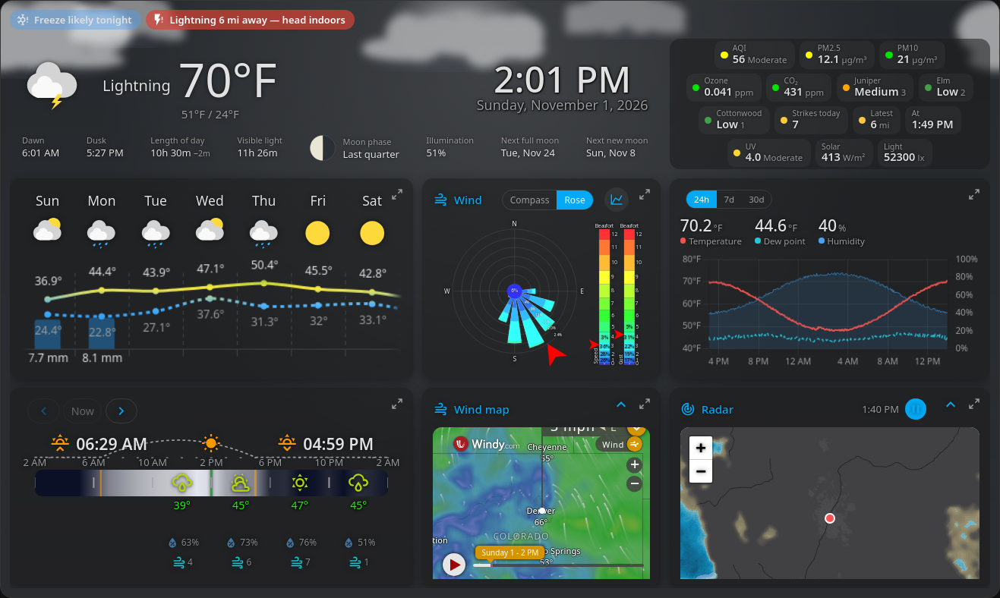</a> 
      Full screen wall tablet
    </td>
    <td align="center" valign="top" width="50%">
      <a href="screenshots/02-full-screen-storm-with-lightning.png">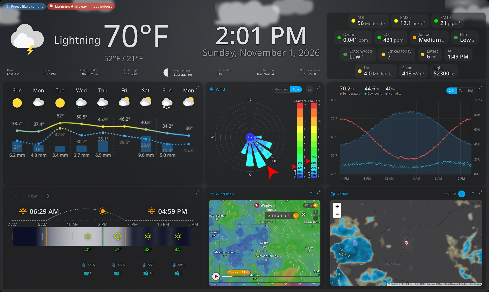</a> 
      Full screen storm with lightning
    </td>
  </tr>
  <tr>
    <td align="center" valign="top" width="50%">
      <a href="screenshots/03-classic-dashboard.png">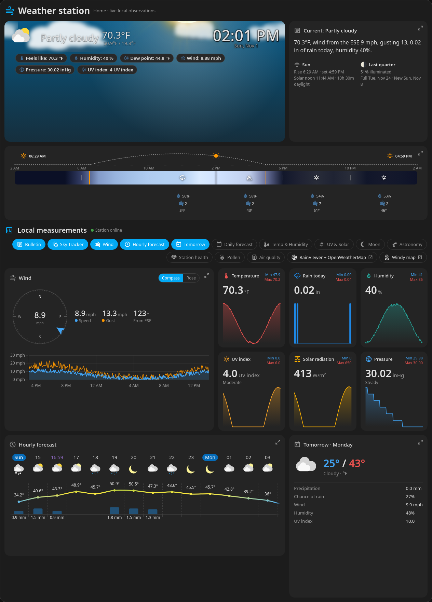</a> 
      Classic dashboard
    </td>
    <td align="center" valign="top" width="50%">
      <a href="screenshots/04-compact-and-merged-tiles.png">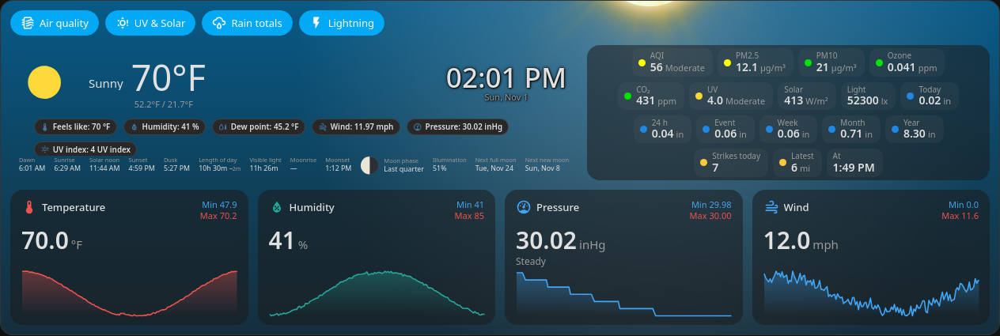</a> 
      Compact and merged tiles
    </td>
  </tr>
  <tr>
    <td align="center" valign="top" width="50%">
      <a href="screenshots/05-charts-rain-and-records.png">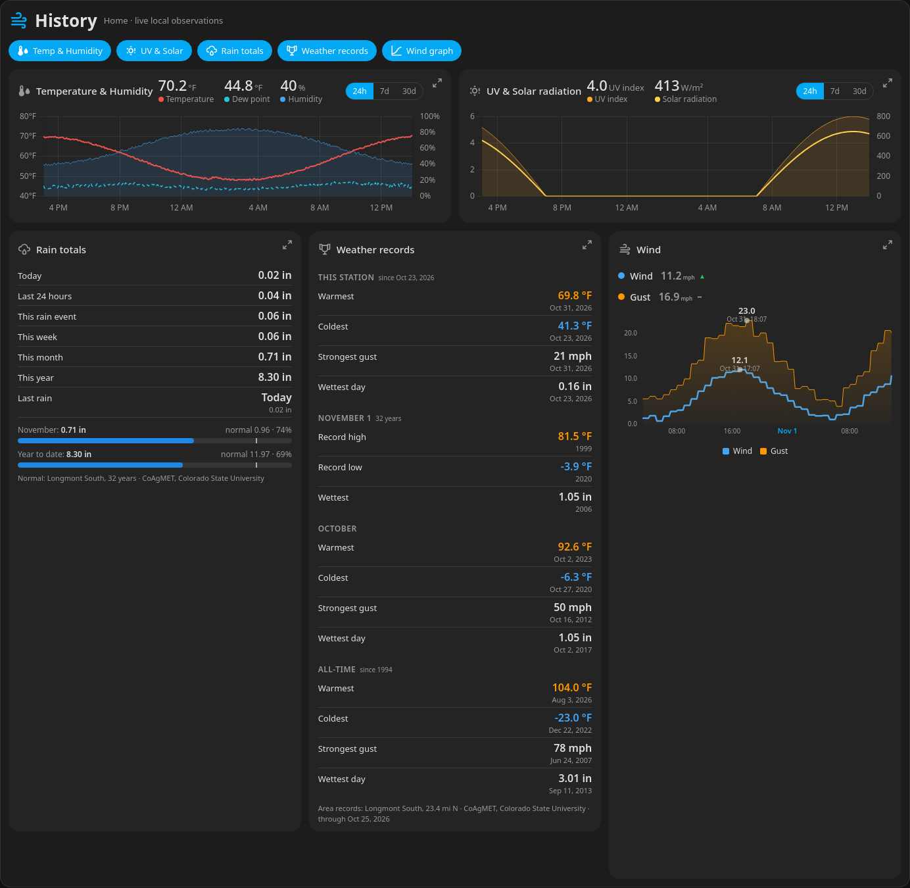</a> 
      Charts rain and records
    </td>
    <td align="center" valign="top" width="50%">
      <a href="screenshots/06-sky-sun-and-moon-light-theme.png">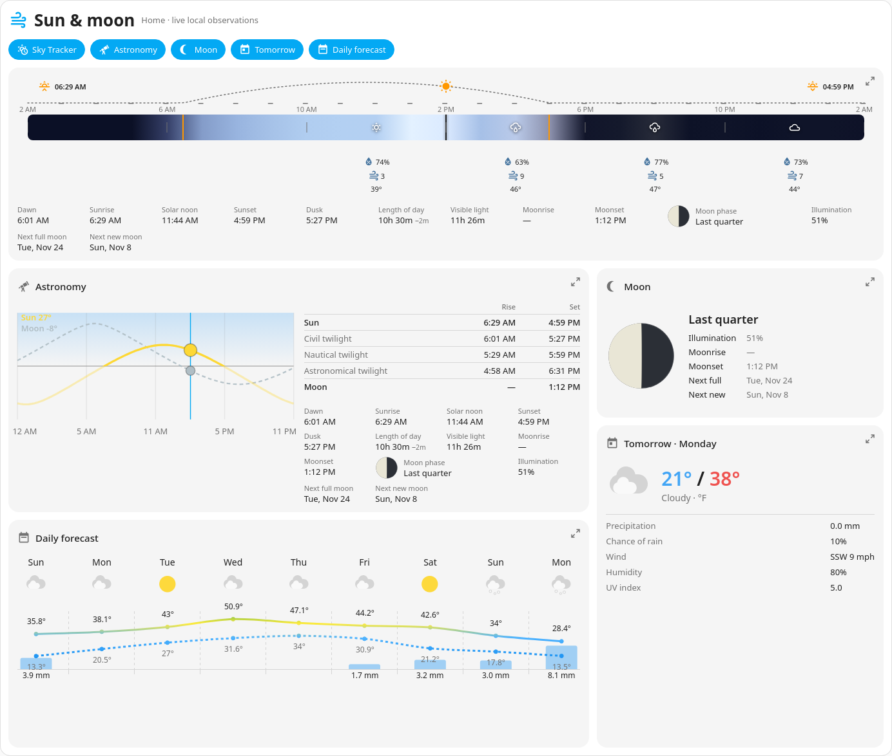</a> 
      Sky sun and moon light theme
    </td>
  </tr>
  <tr>
    <td align="center" valign="top" width="50%">
      <a href="screenshots/07-garden-air-quality-and-pollen.png">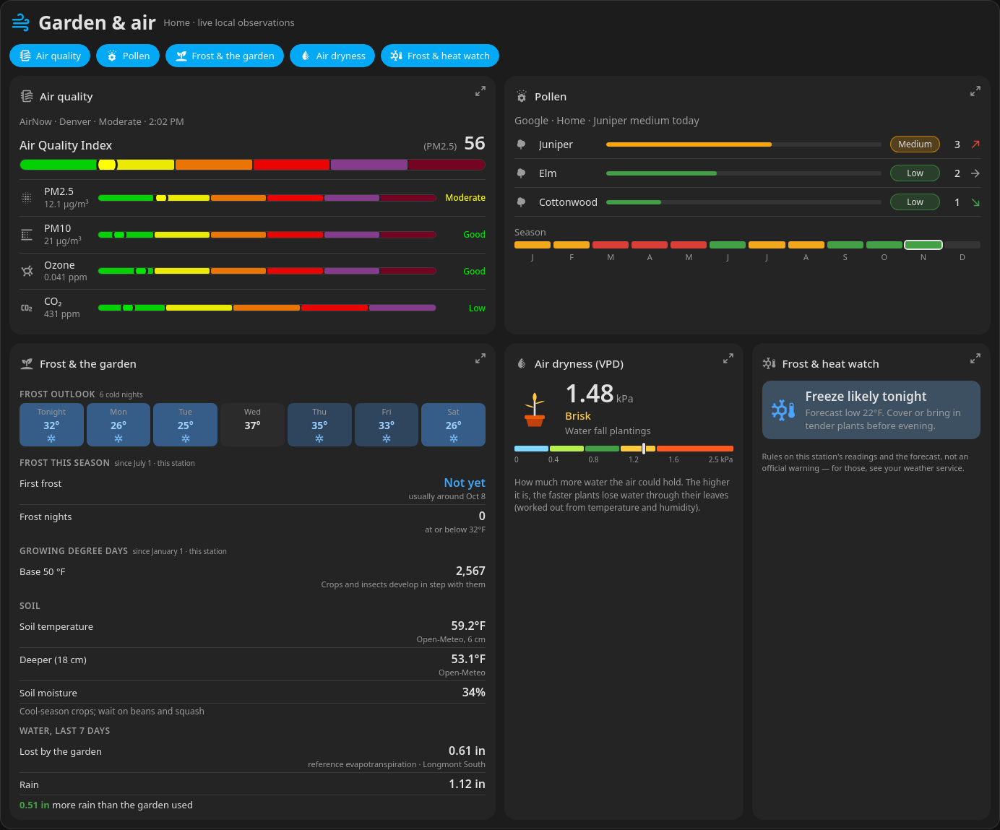</a> 
      Garden air quality and pollen
    </td>
    <td align="center" valign="top" width="50%">
      <a href="screenshots/08-wind-rose-compass-and-maps.png">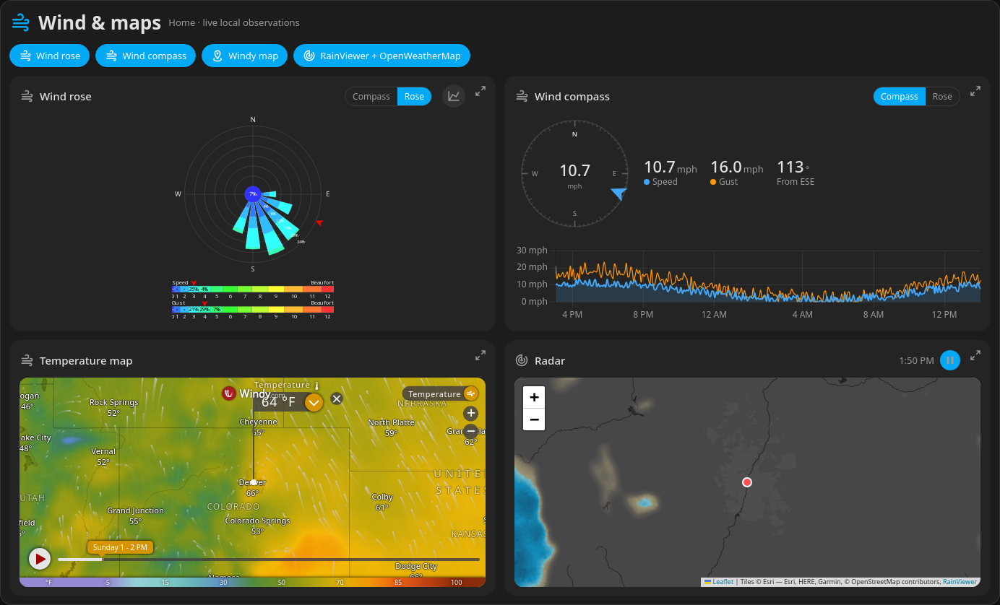</a> 
      Wind rose compass and maps
    </td>
  </tr>
  <tr>
    <td align="center" valign="top" width="50%">
      <a href="screenshots/09-phone-layout.png">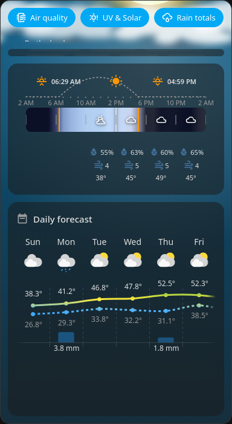</a> 
      Phone layout
    </td>
    <td align="center" valign="top" width="50%">
      <a href="screenshots/10-editor-data-sources.png">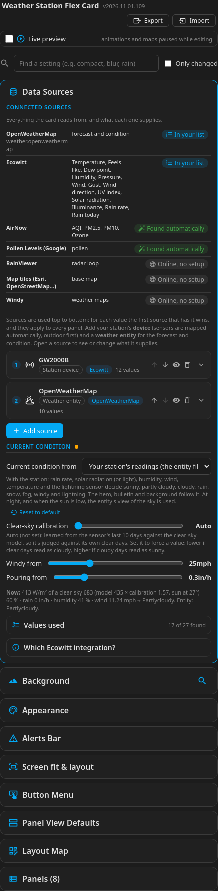</a> 
      Editor data sources
    </td>
  </tr>
  <tr>
    <td align="center" valign="top" width="50%">
      <a href="screenshots/11-editor-layout-map.png">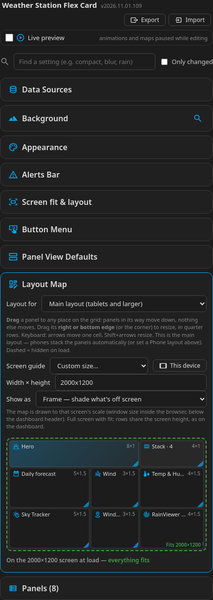</a> 
      Editor layout map
    </td>
    <td></td>
  </tr>
</table>
<!-- SCREENSHOTS:END -->

---

## At a glance

| | |
|---|---|
| Panel types | **31** |
| Card-wide settings | **72** (data sources, background, appearance, alerts, screen fit, panel views) |
| Settings every panel has | **37** (size, position, view, title, style overrides) |
| Settings for particular panels | **334**, plus the hero's, forecasts' and Sky Tracker's own style sections |
| YAML needed | none (everything is in the visual editor) |

---

## Core features

- **Your station first.** Readings come from your weather station, with a forecast service filling the gaps. Sensors are found automatically, and the editor shows every source and what it supplies.
- **Current condition from your station.** Your own rain, solar, humidity, wind and lightning sensors can decide whether it's sunny, cloudy, raining, foggy, windy or stormy.
- **A free-placement grid.** 12 columns, quarter-row heights. Drag panels anywhere on the Layout Map, resize them, and stack them. There are separate tablet and phone layouts.
- **Full-screen wall display.** Fills the screen exactly and scales panels to fit, with a screen guide for designing for your display.
- **Panel views.** Show any panel full size, collapsible to its title, or as a compact row of tiles that opens when tapped, in place, over the others or as a pop-up. Tiles from several panels can be merged into one set.
- **Animated weather background.** Rain, snow, hail, fog, wind, storms with lightning, drifting clouds, the sun by day and stars with the moon by night. You can use your own image instead.
- **Alerts bar.** Shows heat, frost, nearby lightning and official weather alerts, and only while there's something to report.
- **Readable anywhere.** Card-wide text and icon sizes and title colours, text contrast for busy backgrounds, and per-panel overrides.
- **Light on tablets.** A panel only redraws when its own sensors change. Maps and animations pause while you edit, and there's a low-power animation mode.

---

## Panel types

| Group | Panels |
|---|---|
| Current conditions | Hero · Current Weather Metrics · Bulletin · Metric tile · Clock |
| Forecasts | Hourly · Daily · Forecast (both) · Day forecast |
| Sky, sun & moon | Sky Tracker · Astronomy · Moon |
| Wind & maps | Wind (compass or wind rose) · Windy Map (wind, rain, radar, temperature…) · RainViewer + OpenWeatherMap (radar & weather) |
| Graphs | Graph · Temp & Humidity · UV & Solar · Station graph |
| Air & garden | Air quality · Pollen · Air dryness (VPD) · Frost & the garden · Frost & heat watch |
| Records & rain | Weather records · Rain totals · Lightning |
| Station & layout | Station health · Button Menu · Stack · Home Assistant card |

---

## Data sources it works with

| Source | Needed? | Supplies |
|---|---|---|
| A **weather entity** (OpenWeatherMap, NWS, Met.no, Pirate Weather, AccuWeather …) | Yes | Forecasts and the current condition |
| **Ecowitt**, **Ecowitt Local** or **Ecowitt Official** (alone or together), or any station's sensors ([which Ecowitt integration?](docs/ECOWITT_INTEGRATIONS.md)) | Recommended | Your station's readings, lightning, soil and diagnostics |
| [AirNow](https://www.home-assistant.io/integrations/airnow/) or your own air sensors | Optional | Air quality, AQI, PM2.5, PM10, ozone, CO₂ |
| [Pollen Levels](https://github.com/eXPerience83/pollenlevels) (Google), or any pollen sensors you choose | Optional | Pollen |
| [NWS Alerts](https://github.com/finity69x2/nws_alerts) or another alerts sensor | Optional | Weather alerts in the Alerts bar |
| [Wind Rose Card](https://github.com/aukedejong/lovelace-windrose-card) | Optional | The full-featured wind rose |
| [Statistics Graph Chart Card](https://github.com/cataseven/Statistics-Graph-Chart-Card) | Optional | Richer station graphs |
| CoAgMET records package ([`extras/coagmet`](extras/coagmet)), Colorado | Optional | Measured area records, rain normals, frost dates |
| RainViewer, Windy, Open-Meteo, map tiles | Built in, no account | Radar, weather maps, climate history |
| OpenWeatherMap map layers | Optional, free API key | Cloud, rain, wind and temperature map layers |

---

## Installation

**HACS (recommended):** click the badge above, or add `Ltek/weather-station-flex-card` as a custom repository (category **Dashboard**). Install **Weather Station Flex Card (Ltek)**, then hard-refresh your browser.

**Manually:** copy [`dist/`](dist) into `config/www/community/weather-station-flex-card/`. Then add `/local/community/weather-station-flex-card/weather-station-flex-card.js` as a Dashboard resource of type **JavaScript Module**.

Then add **Weather Station Flex Card** from the card picker, choose your weather entity and station under **Data Sources**, and arrange the panels. For a wall display, use a **Panel** view and **Full screen** layout.

It works alongside Weather Flex Card on the same dashboard. Every option is listed in the [configuration reference](docs/CONFIGURATION.md), and [docs/config-examples.md](docs/config-examples.md) has example setups.

---

## Credits

- Base card and animations: [troinine/ha-weather-forecast-card](https://github.com/troinine/ha-weather-forecast-card) (MIT). Layout inspired by [Station Météo](https://github.com/RenaudSub/Station-Meteo).
- Radar: [RainViewer](https://www.rainviewer.com). Weather maps: [Windy](https://www.windy.com). Base maps: Esri, HERE, Garmin, Maxar, © OpenStreetMap contributors. Optional layers: [OpenWeatherMap](https://openweathermap.org). Climate history: [Open-Meteo](https://open-meteo.com).
- Charts: [Chart.js](https://www.chartjs.org). Maps: [Leaflet](https://leafletjs.com). Sun and moon: [SunCalc](https://github.com/mourner/suncalc).

## License

MIT, see [LICENSE](LICENSE).
